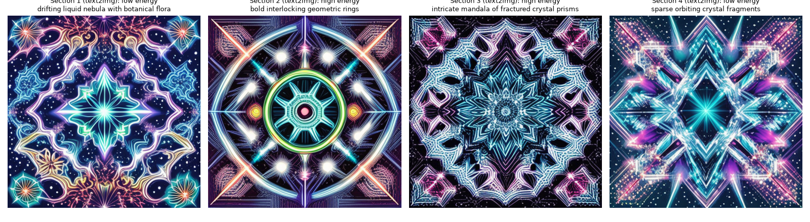
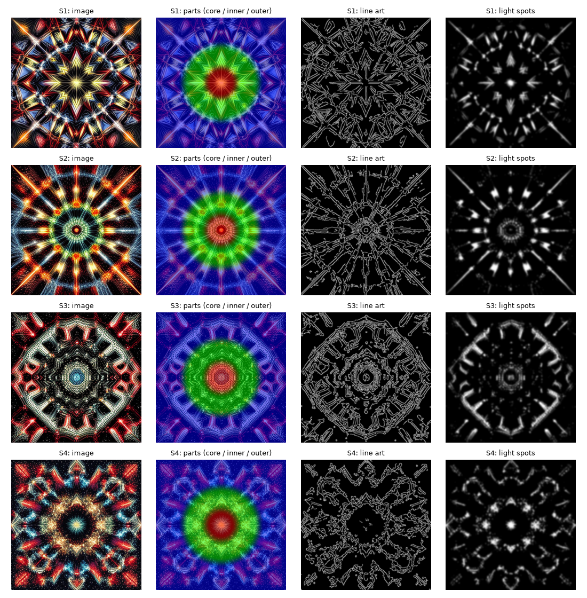
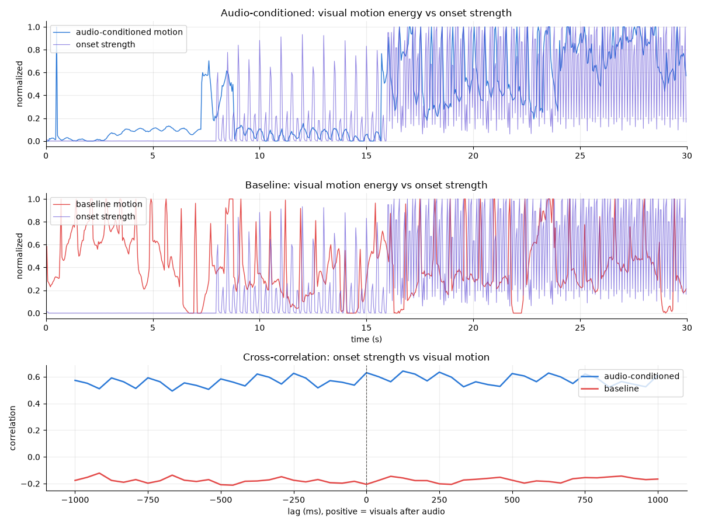

# Section-Aware Procedural GenAI Audio Visualizer

We built a music visualizer in a single Jupyter notebook. It listens to a 30-second music clip, works out what is going on in it
(beats, bass, instruments, vibe, where the song changes), asks a text-to-image model to paint a few abstract images that match the
song, and then animates those images frame by frame so that they move with the music. The output is an MP4 with the original audio.

To check whether the audio actually matters, the notebook also renders a **baseline**: the same images and the same effects, but driven
by fixed timers instead of the music. We compare the two with measurements on the rendered frames, and we include a survey design for
comparing them with real viewers.

<p align="center">
  
</p>

**Watch the demo:** [`outputs/demo_track/videos/visualizer.mp4`](outputs/demo_track/videos/visualizer.mp4) (audio-driven) vs.
[`outputs/demo_track/videos/baseline.mp4`](outputs/demo_track/videos/baseline.mp4) (not audio-driven). GitHub does not play video
inline: open the file and click **View raw** (or download it) to watch it with sound.

---

## Research question

> Can audio-derived features be used to guide generative artwork and procedural animation to create a visualization that feels more
> synchronized and connected to the music than a non-audio-conditioned visualizer?

**Hypothesis:** the audio-conditioned visualizer will get higher ratings for synchronization and connection to the music than the
non-audio-conditioned baseline.

---

## Repository layout

```
Gen_AI_Visualizer/
├── README.md                     ← you are here
├── genai_audio_visualizer.ipynb  ← the whole project: run top to bottom (saved with the demo-track outputs)
├── requirements.txt
├── sample_inputs/
│   ├── README.md                 ← which clips we used and why
│   └── demo_track.wav            ← license-free 30 s track we synthesized (songs are kept local, see below)
├── outputs/
│   ├── demo_track/               ← one folder per song, same layout for every run
│   │   ├── videos/               ← visualizer.mp4 (audio-driven) and baseline.mp4
│   │   ├── images/               ← the generated section images
│   │   ├── figures/              ← every plot from the notebook
│   │   └── tables/               ← sections, prompts, vibe/shape choices, beat changes, instrument events, metrics, survey template
│   ├── naika_barely_barely/      ← same layout (no videos in the repo: they contain copyrighted audio)
│   └── twenty_one_pilots_drag_path/
```

Everything (the code, the explanations and the plots) is in the notebook. There are no separate scripts.

Each run also creates `outputs/<song>/cache/` (the clip audio and the separated instruments). It is git-ignored because it can be
recreated.

---

## Quick start

### 1. Set up the environment (macOS / Linux)

```bash
python3.13 -m venv .venv
.venv/bin/pip install -r requirements.txt
```

No system FFmpeg is needed (`imageio-ffmpeg` ships its own). Image generation uses an NVIDIA GPU if there is one, the Apple-silicon GPU
(MPS) on a Mac, and the CPU otherwise. The first run downloads about 4.5 GB of pretrained models: SD-Turbo (~2.5 GB), CLAP (~600 MB),
Whisper-small (~1 GB), a RoBERTa sentiment model (~500 MB) and Demucs (~80 MB).

### 2. Run the demo

Open `genai_audio_visualizer.ipynb` in Jupyter Lab or VS Code (with the `.venv` kernel) and run all cells, or headless:

```bash
.venv/bin/jupyter nbconvert --to notebook --execute --inplace genai_audio_visualizer.ipynb
```

A full run takes about 3 minutes on an M-series MacBook (the first run is slower because of the model downloads). The generated images
are cached, so re-running does not regenerate them unless the prompts change.

### 3. Run it on another song

Everything is controlled from the **configuration cell (section 3)** of the notebook. To switch songs, change one line and press
**Run All**:

```python
SAMPLE_SONGS = {   # name: (file, clip start in seconds)
    "demo_track":                  ("sample_inputs/demo_track.wav", 0),
    "naika_barely_barely":         ("sample_inputs/naika_barely_barely.mp3", 28),
    "twenty_one_pilots_drag_path": ("sample_inputs/twenty_one_pilots_drag_path.mp3", 105),
    "my_song":                     ("sample_inputs/my_song.mp3", 45),     # ← add your own like this
}
SONG = "my_song"
```

Results land in `outputs/my_song/`. In the same cell, `VIBE_OVERRIDE = "dark"` forces a vibe and `VISUAL_STYLE = "modes"` switches to
the alternative visual style. Tip: pick a 30-second window with some contrast (a build-up, a drop or a breakdown), because that is what
the section and beat-change detection reacts to.

The demo track is generated by the notebook itself; the two songs we tested are copyrighted, so they are not in the repo. Put your own
copy in `sample_inputs/` with the file name above to reproduce those runs.

### Google Colab

Upload the notebook and `sample_inputs/demo_track.wav`, pick **Runtime → Change runtime type → T4 GPU**, and run all. The first code cell
installs the packages Colab does not already have.

---

## How it works

The notebook runs in six parts: **A** audio analysis → **B** song understanding → **C** image generation → **D** animation → **E** evaluation
→ **F** wrap-up. Every tunable number lives in one configuration cell (section 3), so nothing is hidden in the code.

```
audio clip
  ├─► A. features (beats, onsets, RMS, brightness, bass/mid/high) + instrument stems ─► frame-level control timeline (24 fps)
  ├─► B. sections, vibe, song "signature", dramatic beat changes, instrument entrances/exits
  ├─► C. one text prompt per section ─► SD-Turbo ─► 3–4 images ─► split into movable parts
  ├─► D. renderer: every frame warps/recolours the images from the timeline ─► MP4 + original audio
  └─► E. same renderer with fixed timers (baseline) ─► alignment metrics + survey design
```

### A. Audio analysis (notebook sections 4–7.1)

| Step | What we do | Tools |
|---|---|---|
| Load | 30 s clip, mono, 22,050 Hz | librosa |
| Features | onset strength (spectral flux), beat times + tempo, RMS energy, spectral centroid, energy in three bands: bass 20–250 Hz, mid 250–2000 Hz, high 2000–8000 Hz | librosa, NumPy |
| Instruments | split the clip into **drums, bass, vocals and "other"** (synths, guitars, keys), then detect the drum hits on the drum track alone | Demucs `htdemucs` |
| Clean-up | 0.25 s rolling mean, then clip each feature to its 5th–95th percentile and scale it to 0–1 | SciPy |
| Control timeline | resample everything to one row per video frame (720 rows for 30 s at 24 fps); beats and hits become short decaying pulses | pandas |
| Instrument activity | each instrument is switched on/off (with hysteresis and a 2 s minimum) → a list of entrances and exits | — |

A couple of things we were careful about: spectral centroid is a **brightness** measure, not pitch, and RMS is an **energy** measure, not
perceived loudness. Onset spikes are only 1–2 analysis frames wide, so we take the local maximum before resampling to 24 fps; otherwise
many of them fall between video frames and disappear.

### B. Song understanding (sections 8–9.3)

* **Analysis sections.** We build an "activity" curve (`0.5·RMS + 0.3·onset + 0.2·bass`), smooth it, and put section boundaries at
  its biggest jumps (at least 4.5 s apart), giving 3–4 sections. If that fails, the clip is split into equal parts. We call them
  "Section 1, 2, …" because the detector finds change points, not verses or choruses.
* **Vibe** (party / happy / chill / melancholic / dark / epic / bittersweet). Three opinions are combined:
  1. an **acoustic profile** in the spirit of what an audio engineer listens for: tempo, how hard the hits are, how compressed the mix
     is, brightness, major vs. minor key, loudness and noisiness, each scaled to 0–1 and matched against a hand-written profile for
     each vibe;
  2. **CLAP**, a pretrained audio-text model, scoring the clip against a text description of each vibe (zero-shot);
  3. **lyrics**: Whisper transcribes the separated vocals and a sentiment model rates them. If the audio says party/happy but the lyrics
     are mostly negative, the song is called *bittersweet*.

  The final vibe is 50 % acoustic + 50 % CLAP, then the lyrics rule. It sets the colour theme of every prompt.
* **Song signature.** Song-level properties that change the *shapes*, not just the colours: tempo → number of star points (5–12),
  major/minor → rounded petals vs. sharp shards, how drum-heavy the song is → tunnel rings vs. spiral arms, the top two instruments
  from CLAP → materials (e.g. distorted guitar → shattered glass, strings → silk ribbons), and a fingerprint of the audio → the random seed.
* **Dramatic beat changes.** At each section boundary we compare 3 s before and after (drum level, drum-hit rate, bass level, tempo).
  If the biggest change is ≥ 0.5, that section gets a completely new image with a different shape family
  (tunnel, sunburst, crystal, vortex, flower or flowing waves) instead of evolving from the previous one.

### C. Generative images (sections 10–11.1)

* **Prompts** are built from three pieces: the section's shape + the song's form and materials, the vibe's colour theme, and short
  phrases for the section's energy, bass, mid and high levels (low / medium / high at 1/3 and 2/3). SD-Turbo only reads 77 tokens, so
  the notebook checks that no prompt is cut off.
* **SD-Turbo** (a distilled Stable Diffusion 2.1) makes 512×512 images in 2 steps, about 6 s each on a MacBook. Section 1 is
  generated from text; later sections are generated **image-to-image from the previous section** (strength 0.6) so the artwork evolves,
  except after a dramatic beat change, where it starts fresh. Every prompt, seed and setting is saved to `tables/prompts.csv`.
* **Movable parts.** Each image is split into a core, an inner star and an outer ring (by distance from the centre), a line-art layer
  (edge detection) and a "light spots" layer (its brightest pixels), so different parts can follow different instruments.

<p align="center">
  
</p>

### D. Animation (sections 12–14)

The renderer never touches the audio. It reads one row of the control timeline per frame and turns it into visual parameters with simple,
inspectable formulas. The default **psychedelic** style:

| Effect | What you see | Driven by |
|---|---|---|
| Endless zoom | the view keeps zooming into the pattern; new rings keep appearing from the centre | speed: loudness; surges on every beat |
| Beat zoom punch | the view punches in ~10 % on every beat and eases back | beats |
| Kaleidoscope | the image is folded into mirrored wedges that rotate and slide | wedges: mid band; sliding: "other" instruments |
| Instruments in the design | core / inner star / outer ring lines glow **orange / magenta / cyan** as loud as **bass / vocals / other**; a ring blooms when its instrument enters; the number of mirror segments changes when instruments enter or leave | instrument stems + entrances/exits |
| Light spots | the image's bright spots flare and change colour | drum hits |
| Colour cycling | the whole frame slowly rotates through the rainbow | speed: loudness; small step on drum hits |
| Morph transitions | the next section's image melts in (brightest parts first) with a swirl; no hard cuts | 2.5 s normally, 1.5 s at a dramatic beat change |
| Brightness, saturation, sharpness, particles, flashes | overall intensity and detail | RMS, spectral centroid, high band, onsets |

Event effects (beats, hits) swell in over about 2 frames instead of one, because single-frame jumps looked like cuts. Finally, FFmpeg
adds the original audio back and the notebook checks that the video and audio are both exactly 30 s.

**Visual styles.** `--style modes` (or `VISUAL_STYLE=modes`) switches to an alternative where each shape family has its own motion:
kaleidoscope, zoom, shockwave, shatter, spin, sway and liquid flow.

### E. Evaluation (sections 15–17)

* **Baseline.** Same song, images, renderer and effect types. Every continuous control is a constant mid value, pulses repeat on a
  fixed 0.7 s timer (deliberately not the song's tempo), sections change at equal time intervals and no instrument changes happen.
* **Technical checks** on the *rendered frames*, not on our own parameters (correlating RMS with a brightness setting computed from RMS
  would just be true by construction):
  * visual motion energy = mean absolute difference between consecutive frames;
  * Pearson / Spearman correlation of motion energy with onset strength, RMS and the drum/bass stems, for both videos (crossfades excluded);
  * the time lag at which onsets and motion line up best;
  * QA: beats map to pulses, transitions sit on section boundaries, video length = audio length.
* **Survey design.** A within-subjects A/B test: each participant watches both versions (neutral labels, order counterbalanced) and rates
  synchronization (primary outcome), reflecting musical changes, connection to the audio and visual appeal on 1–5, then picks the one
  that represents the music better. The notebook writes an empty response template and analyses it (means, paired differences,
  Wilcoxon signed-rank test) once responses are entered. **No survey data has been collected yet.**

---

## Results so far

Three 30 s clips: the demo track and two songs that are not in the repo (see [`sample_inputs/README.md`](sample_inputs/README.md)).

| | Demo track | Naïka – *BARELY, BARELY* (0:28–0:58) | Twenty One Pilots – *Drag Path* (1:45–2:15) |
|---|---|---|---|
| Tempo / key | 117.5 BPM, A minor | 136 BPM, D# major | 96 BPM, E major |
| Vibe | dark | bittersweet (audio says *happy*, lyrics mostly negative) | epic |
| Shapes per section | star → sunburst → tunnel → crystal | star → crystal → crystal → crystal | star → waves → waves → tunnel |
| Dramatic beat changes | 8.0 s, 16.4 s, 24.0 s | 9.0 s | 11.3 s, 21.1 s |
| Instrument changes | 5 | 21 | 9 |
| **Onset ↔ motion r** (audio vs. baseline) | **0.63** vs. −0.21 | **0.18** vs. −0.12 | **0.29** vs. 0.05 |
| RMS ↔ motion r (audio vs. baseline) | 0.04 vs. −0.30 | 0.14 vs. −0.28 | **0.70** vs. 0.32 |

**What we take from this:**

* On every clip, frame-to-frame motion follows the note/drum onsets more closely in the audio-driven video than in the baseline. That
  is the main sign that the synchronization works as designed. On *Drag Path* the best match is at 0 ms lag.
* The effect is much stronger on the clean electronic demo than on the real pop songs, whose mixes are denser.
* **Ground-truth check on the demo:** we know the kick and bass enter at 8 s and leave at 24 s, and the detector finds exactly those
  instrument changes. The 16 s boundary (hi-hats join) is a borderline case: its change score is exactly at the 0.5 threshold, and
  tiny differences in the instrument separation flip it between "dramatic" and "smooth".
* There is a confound in the RMS numbers: louder sections get busier images, and busier images change more per frame even under the
  baseline's fixed motion. That's why we treat the **onset** correlation as the fairer synchronization test.
* Making the transitions smoother (no cuts) cost some measured beat-locking on the real songs. It's a real trade-off between a calmer,
  more "lo-fi loop" look and a punchier one.

These are implementation checks, not proof that people *perceive* better synchronization. That is what the survey is for.

<p align="center">
  
</p>

---

## Models and tools

| Model | Used for | Notes |
|---|---|---|
| `stabilityai/sd-turbo` | section images (text-to-image and image-to-image) | 512×512, 2–4 steps; check the Stability AI community license before publishing images |
| Demucs `htdemucs` | splitting drums / bass / vocals / other | runs on CPU (Apple MPS lacks an operation it needs), ~15 s per clip |
| `laion/clap-htsat-unfused` | zero-shot vibe and instrument tags | averaged over 10 s windows |
| `openai/whisper-small` | transcribing the vocal track | can mishear sung lyrics (it heard "drag path" as "dry path") |
| `cardiffnlp/twitter-roberta-base-sentiment-latest` | positive / neutral / negative lyrics | we first tried a DistilBERT model, but it crashed on our Mac with PyTorch 2.14 |

Plus librosa, NumPy, SciPy, pandas, OpenCV, Matplotlib, Hugging Face `diffusers` / `transformers`, and FFmpeg via `imageio-ffmpeg`.

---

## Main settings you might want to change

All in the configuration cell (section 3) of the notebook:

| Setting | Default | What it does |
|---|---|---|
| `SONG`, `SAMPLE_SONGS` | `"demo_track"` | which input file to use and where its 30 s clip starts |
| `VISUAL_STYLE` | `psychedelic` | or `modes` for one motion style per shape family |
| `VIBE_OVERRIDE` | auto | force a vibe |
| `N_SECTIONS`, `MIN_SECTION_SEC` | 4, 4.5 s | how many analysis sections, and their minimum length |
| `DRAMATIC_THRESHOLD` | 0.5 | how big a beat change must be to switch to a new image and shape |
| `IMG2IMG_STRENGTH` | 0.6 | how much each section's image may differ from the previous one |
| `VIS["beat_zoom_amp"]`, `VIS["zoom_speed_beat"]` | 0.10, 0.9 | how hard the zoom reacts to beats |
| `VIS["soft_attack_sec"]` | 0.12 s | how gently hits swell in (lower = punchier, higher = smoother) |
| `FORCE_REGENERATE` | `False` | regenerate images even if cached ones exist |

---

## Limitations

* **Nothing here is trained or validated on labelled data.** The vibe profiles, thresholds and visual mappings are design choices that
  we tuned by eye on three clips. A CNN on mel-spectrograms or an LSTM over time would need a dataset of songs labelled by vibe, which we
  don't have, so CLAP stands in as the pretrained model.
* **Features are proxies.** Beat tracking can lock onto half or double tempo, the key estimate can be wrong for ambiguous harmony, and
  instrument separation leaks between tracks ("other" lumps several instruments together).
* **The frequency-to-size mapping** (big, slow shapes for bass, small, fast detail for highs) is inspired by wavelength, but the shapes
  don't physically represent sound waves.
* **Sections are change points**, not verses or choruses, and dramatic changes are only checked at section boundaries.
* **SD-Turbo follows prompts loosely**, especially material words like "silk" or "smoke".
* **Three clips is a tiny test set.** The real-song results are much weaker than the demo's, and the survey has not been run.

## Future work

* Run the survey and report the paired comparison.
* Try more songs and genres, ideally with a few hand-labelled vibes to check the classifier against.
* Train a small vibe classifier on CLAP embeddings once labelled data exists, and let the vibe change during the song.
* Use segmentation masks (e.g. Segment Anything) to animate arbitrary objects in an image, not just rings around the centre.

---

## How we built it

We followed our architecture guide one milestone at a time (audio → features → sections → prompts → images → animation → baseline →
evaluation), then iterated on the look after watching the results. Most of the code was written with an AI coding assistant
(Claude Code).

---

## References

**Audio analysis and music information retrieval**

* McFee, B., Raffel, C., Liang, D., Ellis, D. P. W., McVicar, M., Battenberg, E., & Nieto, O. (2015). librosa: Audio and music signal
  analysis in Python. *Proceedings of the 14th Python in Science Conference.* https://librosa.org/doc/latest/index.html
* Ellis, D. P. W. (2007). Beat tracking by dynamic programming. *Journal of New Music Research, 36*(1), 51–60.
* Bello, J. P., Daudet, L., Abdallah, S., Duxbury, C., Davies, M., & Sandler, M. B. (2005). A tutorial on onset detection in music
  signals. *IEEE Transactions on Speech and Audio Processing, 13*(5), 1035–1047.
* Krumhansl, C. L. (1990). *Cognitive Foundations of Musical Pitch.* Oxford University Press.
* Kim, Y. E., Schmidt, E. M., Migneco, R., Morton, B. G., Richardson, P., Scott, J., Speck, J. A., & Turnbull, D. (2010). Music emotion
  recognition: A state of the art review. *Proceedings of ISMIR 2010.*
* Choi, K., Fazekas, G., Sandler, M., & Cho, K. (2017). Convolutional recurrent neural networks for music classification.
  *Proceedings of ICASSP 2017.*

**Generative and pretrained models**

* Rombach, R., Blattmann, A., Lorenz, D., Esser, P., & Ommer, B. (2022). High-resolution image synthesis with latent diffusion models.
  *Proceedings of CVPR 2022.*
* Sauer, A., Lorenz, D., Blattmann, A., & Rombach, R. (2023). Adversarial diffusion distillation. *arXiv:2311.17042.*
  SD-Turbo model card: https://huggingface.co/stabilityai/sd-turbo
* Rouard, S., Massa, F., & Défossez, A. (2023). Hybrid transformers for music source separation. *Proceedings of ICASSP 2023.*
  https://github.com/adefossez/demucs
* Wu, Y., Chen, K., Zhang, T., Hui, Y., Berg-Kirkpatrick, T., & Dubnov, S. (2023). Large-scale contrastive language-audio pretraining
  with feature fusion and keyword-to-caption augmentation. *Proceedings of ICASSP 2023.* https://huggingface.co/laion/clap-htsat-unfused
* Radford, A., Kim, J. W., Xu, T., Brockman, G., McLeavey, C., & Sutskever, I. (2023). Robust speech recognition via large-scale weak
  supervision. *Proceedings of ICML 2023.* https://huggingface.co/openai/whisper-small
* Loureiro, D., Barbieri, F., Neves, L., Espinosa Anke, L., & Camacho-Collados, J. (2022). TimeLMs: Diachronic language models from
  Twitter. *Proceedings of ACL 2022: System Demonstrations.* https://huggingface.co/cardiffnlp/twitter-roberta-base-sentiment-latest

**Software and documentation**

* Hugging Face Diffusers: https://huggingface.co/docs/diffusers (text-to-image, image-to-image and SDXL-Turbo pipelines)
* Hugging Face Transformers: https://huggingface.co/docs/transformers
* Bradski, G. (2000). The OpenCV library. *Dr. Dobb's Journal of Software Tools.* https://opencv.org
* FFmpeg: https://ffmpeg.org (bundled through `imageio-ffmpeg`)

**Inspiration**

* python-audio-reactive-visualizer (LibROSA + OpenCV): https://github.com/actionoise/python-audio-reactive-visualizer
* Deforum Stable Diffusion (no longer maintained; used only as inspiration): https://github.com/deforum/deforum-stable-diffusion
