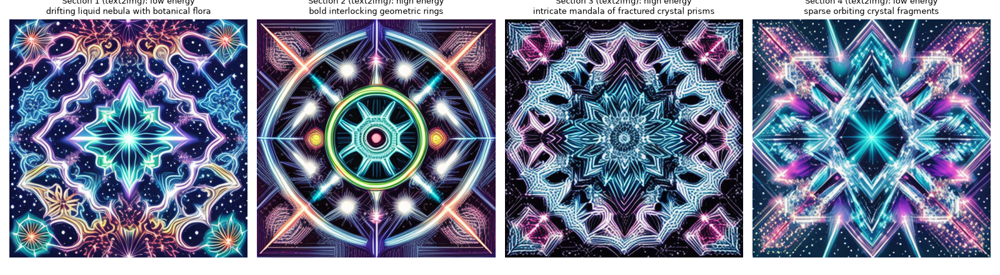
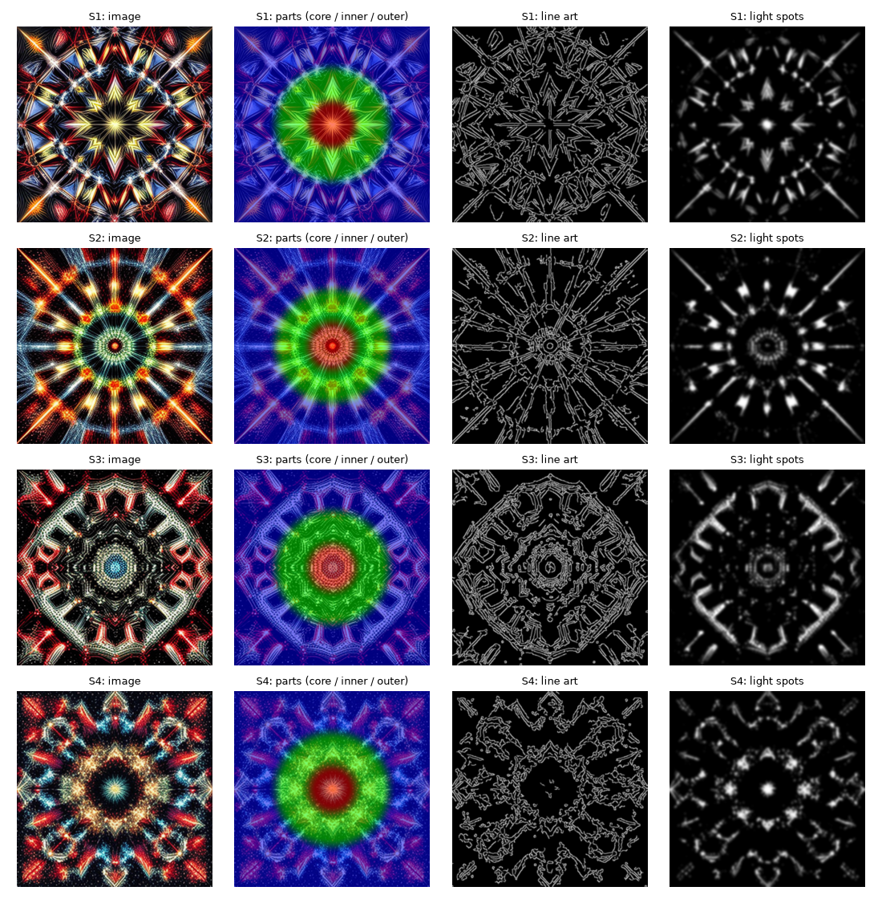
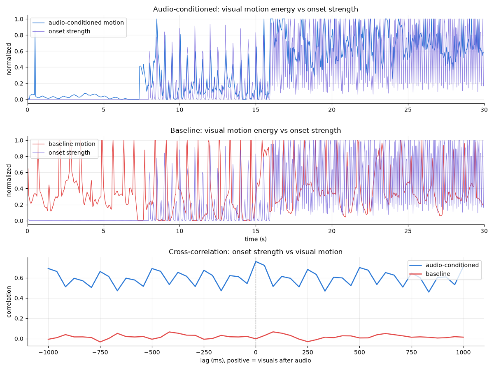

# Section-Aware Procedural GenAI Audio Visualizer

A music visualizer built in a single Jupyter notebook. It listens to a 30-second clip, works out what is happening in it (beats,
instruments, key, mood, where the song changes), generates a few abstract images that match the song, and animates them frame by
frame so they move with the music. The output is an MP4 with the original audio. Optional artist controls supply known
song information, a visual medium and colours while retaining musical reactions.

Final project for MSDS 466 (Applied Generative AI for Enterprises), by Samin Bahizad and Wendy Zhang.

<p align="center">
  
</p>

**Demo:** [`visualizer.mp4`](outputs/demo_track/videos/visualizer.mp4) (audio-driven) vs. [`baseline.mp4`](outputs/demo_track/videos/baseline.mp4)
(not audio-driven). GitHub does not play video inline, so click **View raw** or download the file to watch it with sound.

## Research question

> Can audio-derived features guide generative artwork and animation so that the result feels more synchronized and connected to the
> music than a visualizer that ignores the audio?

**Hypothesis:** the motion in the audio-driven visualizer will line up with the music more closely than the baseline's.

The **baseline** uses the same images and effects, but runs them on fixed timers instead of the music. We compare the two with
measurements on the rendered frames (see [Evaluation](#evaluation)).

## Repository layout

```
Gen_AI_Visualizer/
├── genai_audio_visualizer.ipynb  ← the whole project, run top to bottom
├── requirements.txt
├── sample_inputs/                ← input clips (see sample_inputs/README.md)
└── outputs/
    ├── all_songs.csv             ← every song's results side by side (Section 25)
    └── <song>/                   ← one folder per song
        ├── videos/               ← visualizer.mp4 and baseline.mp4
        ├── images/               ← generated section images
        ├── figures/              ← plots from the notebook
        └── tables/               ← features, palettes, prompts, settings, metrics and test report
```

There are no separate scripts. The two real songs are copyrighted, so their audio and videos are not in the repo. Each run also
creates a git-ignored `cache/` folder with the clip audio and separated instruments.

## Quick start

Rename the downloaded notebook to `genai_audio_visualizer.ipynb`, or substitute its filename below. Review section 2 and
**Artist Creative Controls** before running.

```bash
python3.13 -m venv .venv
.venv/bin/pip install -r requirements.txt
.venv/bin/jupyter nbconvert --to notebook --execute --inplace genai_audio_visualizer.ipynb
```

You can also open the notebook in Jupyter Lab or VS Code with the `.venv` kernel and run all cells. No system FFmpeg is needed.
It uses an NVIDIA GPU, an Apple-silicon GPU or the CPU, whichever is available.

The original setup downloaded about 4.5 GB of models; updated runtime is not rebenchmarked. Images are cached until prompts or upstream
images change. Demucs is required by default rather than silently substituting proxy stems.

**Using another song:** put the file in `sample_inputs/`, add it to `SAMPLE_SONGS` in the configuration cell (section 2) and set `SONG`:

```python
SAMPLE_SONGS = {   # name: (file, clip start in seconds)
    "demo_track": ("sample_inputs/demo_track.wav", 0),
    "my_song":    ("sample_inputs/my_song.mp3", 45),
}
SONG = "my_song"
```

Results go to `outputs/my_song/`. Pick a 30-second window with some contrast (a build-up, drop or breakdown), since that is what the
section detection reacts to. Reset song-specific artist inputs and back up prior outputs before rerunning.

### Artist creative controls

**Artist input takes precedence over analysis, then defaults.** Detected and resolved values are saved separately.

```python
ARTIST_CONTROLS = {
    "song_title": None,       # Display metadata only; SONG selects the audio.
    "artist_name": None,
    "lyrics": None,           # Plain text; multiline text can use triple quotes.
    "key": None,              # Tonic only, e.g. "G", "F#" or "Bb".
    "mode": None,             # "major" or "minor".
    "bpm": None,              # Number from 20 to 300, not quoted text.
    "visual_preset": None,    # "neon_filigree", "painted_ribbons", "carved_clay", "glass_facets".
    "colors": None,           # Range name, palette list, or hue-range tuple (examples below).
}
```

Presets change **only the medium**. `None` restores the archetype-selected style; subjects, lighting and motion remain music-driven.
Mood/archetype overrides have been removed.

`colors` accepts a named range (`"cool"`, `"warm"`, `"blue"`, `"purple"`, `"pink"`, `"green"`), a list of 1–8 supported names/hex colours
(e.g. `["blue", "purple", "pink"]`), or a clockwise hue tuple `(210, 330)`. `"purple"` means a range; `["purple"]` means one colour.

BPM guides tracking, not a metronome. Key/mode do not force chord labels. Supplied lyrics replace transcription, not word alignment.
Set inputs to `None` for automatic behavior.

## How it works

| Part | Notebook sections | What happens |
|---|---|---|
| **A. Audio analysis** | 3–8 | Extract beats, energy, brightness and bass/mid/high levels. Separate four stems with Demucs, detect overlapping drum families, extract chroma/chords, and build controls at 24 fps. |
| **B. Song understanding** | 9–14 | Find 3–4 change-point sections and classify musical archetypes. Corroborate dramatic changes with energy/bass evidence and assign section motion profiles. |
| **C. Images** | 15–17 | Build one prompt per section and generate 3–4 images with SD-Turbo. Split each image into parts (core, inner star, outer ring, line art, light spots) that can move separately. |
| **D. Animation** | 18–21 | Animate the images from the per-frame timeline and add the original audio back. |
| **E. Evaluation** | 22–24 | Render the baseline, measure audio–visual alignment, and test the analysis against the demo track's known answers. |
| **F. Wrap-up** | 25–27 | Results summary (with every song side by side), test report and conclusion. |

Technical settings are in section 2; optional artist inputs are in **Artist Creative Controls** immediately after it.
Every `check(...)` line in the notebook is a test that prints `[PASS]`,
`[WARN]` or `[FAIL]`. Pipeline tests stop the run when something is broken; quality tests only warn. Section 26 collects them in
`tables/test_report.csv`.

### Song understanding

The archetype comes from two sources averaged 50/50:

* **Acoustic features** matched against a hand-written prototype for each archetype: key (major/minor), how driving the drums are,
  how tight they sit on the grid, brightness, which instrument dominates, energy and distortion.
* **CLAP**, a pretrained audio–text model, scoring the clip against a one-line description of each archetype.

With lyric analysis enabled, a sentiment model rates supplied lyrics or Whisper transcription in chunks. Upbeat music with mostly
negative lyrics is **bittersweet**: the shared colours become muted, not forcibly blue.

Each section blends the motion profiles of its top two archetypes, so a quiet breakdown in an upbeat song can calm down.
Visual presets do not force motion profiles.

### Shared harmonic colours

CQT chroma, 24 major/minor triad templates and Viterbi smoothing estimate chords (`N` means uncertain); local tonal context spans about
eight seconds. Pitch classes map around the Circle of Fifths in 30-degree hue steps.

One selector supplies renderer gradients and section-prompt summaries. Reliable chords use root/third/fifth colours; uncertainty briefly
holds colours, then falls back to chroma. Circular smoothing prevents wraparound jumps. Mode, brightness and energy shape intensity.

Artist colours constrain both pipelines. A 40% tint preserves source detail, saturation variation and highlights. Harmonic features,
chord segments and palette decisions are exported.

### Motion profiles

| Profile | What it looks like |
|---|---|
| party | hard beat zooms, many mirror segments, strong flashes |
| euphoric | bouncy, bright and saturated, moderate flashes |
| chill | slow drift, gentle camera sway, few segments, no flashes |
| melancholic | minimal: slow rotation, muted colours, long transitions |
| dark_synth | moody and steady: high contrast, deep swirl |
| aggressive | chaotic: the image shatters into tiles and spins on drum hits |
| groove | bouncy: the centre swells with the bass, thick lines, swinging camera |
| cinematic | deep: fast zoom, big swirling transitions, slow brightness swells |

### Images

Each prompt retains the original four-part structure:

| Part | Chosen by | Example |
|---|---|---|
| Art style | archetype, or optional medium preset | party → *retro-futuristic cyberpunk neon vector art* |
| Subject | section energy and rhythm | high and driving → *intricate mandala of fractured crystal prisms* |
| Colours | shared harmonic/artist palette | the same representative hue families used by the renderer |
| Lighting | brightness and rhythm | dark → *volumetric fog, soft bioluminescence* |

The first section's image is generated from text. Later sections start from the previous image so the artwork evolves, unless there was
a big beat change, in which case they start fresh. When a section's subject changes, it is allowed to differ more from the previous
image, so the new subject actually shows. All prompts and seeds are saved to `tables/prompts.csv`.

Groove subjects now use flowing ribbons rather than rings. Actual CLIP tokenization enforces 77 tokens while preserving
`N-fold symmetry, centered on dark background` and required prompt components.

<p align="center">
  
</p>

### Animation

Every frame is drawn from the timeline with simple formulas. In the default style:

| Music | What you see |
|---|---|
| Loudness | zoom speed, brightness and colour intensity |
| Harmony | evolving shared gradient colours, or variations within artist colours |
| Kick | zoom punch and the centre swells |
| Snare | kaleidoscope twist, white flash, light spots flare |
| Hi-hats | sparkling particles |
| Vocals | inner-star motion and glow using the selected palette |
| Bass / vocals / other | core / inner / outer accents using shared harmonic or artist colours |
| Instrument enters or leaves | a ring blooms and the number of mirror segments changes |
| New section | the next image melts in with a swirl, no hard cuts |

The original kaleidoscope remains. Causal pulses follow detected hits; quiet passages reduce motion, particles and emission.
Eased fades avoid overlap, and silence suppresses every layer.

Set `VISUAL_STYLE = "modes"` for an alternative style where each shape family has its own motion.

### Evaluation

* **Baseline:** same images, effects and static colour direction, but timer-driven controls: pulses every 0.7 s and sections at equal
  intervals. It tests temporal musical guidance, not completely audio-independent image generation.
* **Alignment:** decode both MP4s through the same measurement function and use common masks/events. Correlate frame motion with
  `onset_strength_continuous` and RMS; keep causal `onset_event_pulse` separate. Local lag is reported separately from beat-ambiguous global peaks.
* **Event-locked contrast:** motion around kicks, snares, hats or vocal accents divided by preceding motion, with block-bootstrap
  intervals. Above 1 indicates a reaction; responding to a detected event does not prove its label is correct.
* **Ground truth:** score the synthesized demo against known events. Initial instrument presence is separate from interior transitions.
  Real-song events are detector outputs unless independent annotations are supplied.

Regional responses, image contrast and palette coverage are also exported. `evaluation_manifest.json` records metric definitions,
versions, hashes and event provenance. `REFERENCE_VIDEO` can rescore a separately saved original video using the current evaluator.

## Results

Three 30-second clips: the demo track and two real songs (see [`sample_inputs/README.md`](sample_inputs/README.md)).
Values follow the **latest saved Section 25 summary** (`continuous-onset-fixed-events-v3`), not the earlier ZIP. Detailed result cells
are partly cleared; re-export matching CSVs/manifests when reproducing this snapshot.

| | Demo track | Naïka – *BARELY, BARELY* | Twenty One Pilots – *Drag Path* |
|---|---|---|---|
| Resolved tempo / key (artist supplied) | 120 BPM, A minor | 103 BPM, G minor | 95 BPM, E major |
| **Archetype** (runner-up) | **party** (groove) | **groove** (euphoric) | **euphoric** (cinematic) |
| Section profiles | dark_synth → groove → party → dark_synth | euphoric → groove → groove → groove | euphoric → chill → chill → euphoric |
| Art style | neon filigree | impasto oil painting | carved clay relief |
| **Onset ↔ motion r** (audio vs. baseline) | **0.54** vs. −0.20 | **0.21** vs. −0.06 | **0.26** vs. −0.08 |
| Loudness ↔ motion r | 0.49 vs. −0.09 | 0.46 vs. −0.46 | 0.58 vs. 0.06 |
| **Kick contrast** | **4.21×** vs. 1.36× | **1.81×** vs. 0.94× | **2.38×** vs. 0.99× |
| Snare contrast | 4.89× vs. 0.67× | 1.61× vs. 0.87× | 1.55× vs. 1.05× |
| Vocal contrast | (no vocals) | 1.08× vs. 1.03× | 1.65× vs. 1.01× |

Artist inputs are not detector accuracy: the demo estimate remains 117.45 BPM. Changed images, inputs and evaluation rules prevent
historical scores from isolating one modification.

<p align="center">
  
</p>

**What we learned:**

* Onset correlation exceeds every timer baseline but is lower than the original. Kick/snare reactions strengthened; vocal results remain less convincing.
* The latest demo checks give F1 **1.00** for unique drum-event times, kicks, all 112 hats, section boundaries and dramatic changes.
  Snare F1 is **0.59**: eight claps matched, with 11 extra labels. Beat F1 remains **0.78** and interior instrument-change F1 **0.67**.
* Matching allows 50 ms drum error; hats now include overlaps and initial presence is scored separately. The demo local lag is one frame (+41.7 ms).
* Artist materials/colours coexist with music-driven motion; *Drag Path's* breakdown remains *chill*. Chord uncertainty and snare precision persist.

These numbers show the system works as designed. They do not prove that people *perceive* better synchronization; a viewer study remains a next step.

## Models

| Model | Used for |
|---|---|
| `stabilityai/sd-turbo` | generating the section images |
| Demucs `htdemucs` | splitting drums, bass, vocals and other |
| `laion/clap-htsat-unfused` | archetype and instrument tags |
| `openai/whisper-small` | transcribing vocals when lyrics are not supplied |
| `cardiffnlp/twitter-roberta-base-sentiment-latest` | lyric sentiment |

Plus librosa, NumPy, SciPy, pandas, OpenCV, Matplotlib, Hugging Face `diffusers` / `transformers`, and FFmpeg via `imageio-ffmpeg`.
Check the model licenses before publishing generated images.

## Main settings

Technical settings are in section 2; `ARTIST_CONTROLS` is in the next labelled cell:

| Setting | Default | What it does |
|---|---|---|
| `SONG`, `SAMPLE_SONGS` | `"demo_track"` | input file and clip start; inspect retained settings |
| `VISUAL_STYLE` | `psychedelic` | or `modes` |
| `ARTIST_CONTROLS` | optional | known song information, visual medium and colours |
| `THEORY["palette_mix"]` | 0.40 | partial shared-palette tint |
| `REQUIRE_DEMUCS` | `True` | stop if learned source separation is unavailable |
| `DRUM_GENERIC_POLICY` | `"diagnostic"` | keep unmatched candidates out of trusted drum controls |
| `SECTION_PROFILE_WEIGHT` | 0.4 | how much a section's own sound changes its motion |
| `CLAP_TEMPERATURE` | 2.0 | how much CLAP's confidence is softened |
| `N_SECTIONS`, `MIN_SECTION_SEC` | 4, 4.5 s | number of sections and their minimum length |
| `DRAMATIC_THRESHOLD` | 0.5 | how big a beat change must be to start a new image |
| `IMG2IMG_STRENGTH` | 0.6 | how much each image may differ from the previous one |
| `IMG2IMG_STRENGTH_NEW_SUBJECT` | 0.8 | the same, when the section's subject changes |
| `VIS`, `PROFILES` | — | animation settings and the eight motion profiles (section 14) |
| `FORCE_REGENERATE` | `False` | regenerate images even if cached |
| `REFERENCE_VIDEO` | `None` | optionally rescore an original MP4 on the same evaluation targets |

## Limitations

* **No project-specific training.** Pretrained models are not fine-tuned; archetypes, profiles and thresholds are design choices tuned on three clips.
* **Features are estimates.** Beat tracking can lock onto half or double tempo, key detection can be wrong, and instruments leak
  between separated tracks.
* **Sections are change points**, not verses or choruses.
* **Snare labels, beat recall and instrument-exit timing remain weak.** Demo kick/hat success does not establish real-song accuracy.
* **Chord estimates are uncertain**, especially on commercial music; held/chroma fallback colours are not validated chord transcription.
* **Colour mappings are artistic rules**, not a universal model of synesthetic perception.
* **SD-Turbo follows prompts loosely**: it gets the style and colours right more often than the subject.
* **Three clips is a tiny test set**, and we have not tested with viewers yet.
* **Scope:** only 3–4 images per song, and all motion comes from warping them. No frame-by-frame diffusion, real-time rendering or 3D.

## Future work

* Run a viewer survey comparing the two versions.
* Test more songs and genres, with independent beat, drum and chord annotations as well as hand-labelled archetypes.
* Improve snare precision, vocal reactivity and real-song harmonic confidence; preserve clear effects without excessive illumination.
* Train a small archetype classifier on CLAP embeddings once labelled data exists.

## Modification log

| # | Problem | Change | Result |
|---|---|---|---|
| 1 | motion lagged onsets by 250 ms | keep onset peaks when resampling to 24 fps | lag 0 ms |
| 2 | frames washed out to white | softer edges, fewer light spots | clean frames |
| 3 | images looked alike across songs | song-based seeds, chained images, archetype prompts | three distinct styles |
| 4 | the demo's drop at 24 s was missed | use the largest single change, not the sum | detected |
| 5 | too many instrument changes | smoothing + 2 s minimum | matches the demo's ground truth |
| 6 | sentiment model crashed | switched to RoBERTa | lyrics analysis works |
| 7 | every song came out "euphoric" | soften CLAP + consistent label wording | party, groove, euphoric |
| 8 | transitions and hits looked like cuts | softer attack, longer morphs | smooth, at some cost to sync |
| 9 | colour cycling erased each palette | colours swing around the song's palette | palettes stay recognizable |
| 10 | real songs felt out of sync | separate effects for kick, snare, hi-hat, vocals | Naïka onset r 0.21 → 0.36 |
| 11 | snares were invisible | snare twist + flash | 1.20× vs 0.80× baseline |
| 12 | analysis never checked against known answers | ground-truth test + test report | drum labels found to be the open issue |
| 13 | Naïka's sections 2–4 looked almost the same (similarity 0.92–0.93) | image-to-image strength 0.8 when a section's subject changes | similarity 0.63–0.72; each section shows its own subject |

---

| # | Problem | Change | Outcome |
|---|---|---|---|
| 14 | Detection can be improved with human-in-the-loop | Manual lyrics/key/BPM and override records | Artist knowledge supplements measured audio. |
| 15 | Artist controls are too complicated and can clash with each other | One medium preset plus colorrs; removed mood/archetype overrides | Original prompt structure, audio-derived motion; groove subjects refined to ribbons. |
| 16 | Color changes are not tied to music | Shared Circle-of-Fifths/chord palette | Consistent prompt/render colours with artist constraints. |
| 17 | Colors looked muddy after change | Partial tint and shared accents | Preserved highlights, texture and saturation variation. |
| 18 | Drum kit detection could be improved | Independent drum families and diagnostic-only generic events | Demo kick/hat F1 1.00; snare false positives remain. |
| 19 | Music could be too "reactive" | Quieter activity, eased fades, and corroborated dramatic changes | More selective reactions; no extra middle dramatic change on the demo. |

## References

**Audio analysis and music information retrieval**

* McFee, B., Raffel, C., Liang, D., Ellis, D. P. W., McVicar, M., Battenberg, E., & Nieto, O. (2015). librosa: Audio and music signal
  analysis in Python. *Proceedings of the 14th Python in Science Conference.* https://librosa.org/doc/latest/index.html
* Ellis, D. P. W. (2007). Beat tracking by dynamic programming. *Journal of New Music Research, 36*(1), 51–60.
* Bello, J. P., Daudet, L., Abdallah, S., Duxbury, C., Davies, M., & Sandler, M. B. (2005). A tutorial on onset detection in music
  signals. *IEEE Transactions on Speech and Audio Processing, 13*(5), 1035–1047.
* Krumhansl, C. L. (1990). *Cognitive Foundations of Musical Pitch.* Oxford University Press.
* Kim, Y. E., Schmidt, E. M., Migneco, R., Morton, B. G., Richardson, P., Scott, J., Speck, J. A., & Turnbull, D. (2010). Music emotion
  recognition: A state of the art review. *Proceedings of ISMIR 2010.*
* Choi, K., Fazekas, G., Sandler, M., & Cho, K. (2017). Convolutional recurrent neural networks for music classification.
  *Proceedings of ICASSP 2017.*

**Generative and pretrained models**

* Rombach, R., Blattmann, A., Lorenz, D., Esser, P., & Ommer, B. (2022). High-resolution image synthesis with latent diffusion models.
  *Proceedings of CVPR 2022.*
* Sauer, A., Lorenz, D., Blattmann, A., & Rombach, R. (2023). Adversarial diffusion distillation. *arXiv:2311.17042.*
  SD-Turbo model card: https://huggingface.co/stabilityai/sd-turbo
* Rouard, S., Massa, F., & Défossez, A. (2023). Hybrid transformers for music source separation. *Proceedings of ICASSP 2023.*
  https://github.com/adefossez/demucs
* Wu, Y., Chen, K., Zhang, T., Hui, Y., Berg-Kirkpatrick, T., & Dubnov, S. (2023). Large-scale contrastive language-audio pretraining
  with feature fusion and keyword-to-caption augmentation. *Proceedings of ICASSP 2023.* https://huggingface.co/laion/clap-htsat-unfused
* Radford, A., Kim, J. W., Xu, T., Brockman, G., McLeavey, C., & Sutskever, I. (2023). Robust speech recognition via large-scale weak
  supervision. *Proceedings of ICML 2023.* https://huggingface.co/openai/whisper-small
* Loureiro, D., Barbieri, F., Neves, L., Espinosa Anke, L., & Camacho-Collados, J. (2022). TimeLMs: Diachronic language models from
  Twitter. *Proceedings of ACL 2022: System Demonstrations.* https://huggingface.co/cardiffnlp/twitter-roberta-base-sentiment-latest

**Software and documentation**

* Hugging Face Diffusers: https://huggingface.co/docs/diffusers
* Hugging Face Transformers: https://huggingface.co/docs/transformers
* Bradski, G. (2000). The OpenCV library. *Dr. Dobb's Journal of Software Tools.* https://opencv.org
* FFmpeg: https://ffmpeg.org

**Inspiration**

* python-audio-reactive-visualizer (LibROSA + OpenCV): https://github.com/actionoise/python-audio-reactive-visualizer
* Deforum Stable Diffusion: https://github.com/deforum/deforum-stable-diffusion
